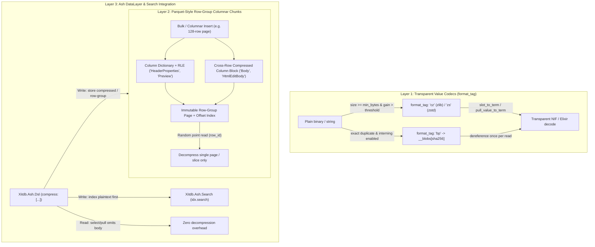

# Specification: Parquet-Style Columnar & Transparent Blob Compression for `xitdb`

> [!IMPORTANT]
> **Track Metadata:**
> - **Track ID:** `parquet_email_body_compression_20261119`
> - **Type:** `feature`
> - **Target Repository:** `xitdb` (`/home/pauli/projects/elixir/xitdb`)
> - **Primary Modules & Files:** `native/xitdb_nif.odin`, `lib/xitdb.ex`, `lib/xitdb/compression.ex`, `lib/xitdb/columnar.ex`, `lib/xitdb/tx_compiler.ex`, `lib/xitdb/cursor.ex`, `lib/xitdb/pull.ex`, `lib/xitdb/ash/dsl.ex`, `lib/xitdb/ash/data_layer.ex`, `lib/xitdb/ash/mutator.ex`, `lib/xitdb/ash/query.ex`, `lib/xitdb/ash/search.ex`
> - **Motivating Workload:** CAASA Connect Creatio `Activity` raw ingestion (`543,266+` rows with `Body`, `HtmlEditBody`, `Preview`, and `HeaderProperties`, ~3.5 GB Parquet / **11+ GB** uncompressed `.xit` observed during full OData sync) where consecutive emails share massive HTML templates, CSS wrappers, disclaimers, signatures, and MIME headers.
> - **Reference Compression Implementations (`hugi`):** `/home/pauli/projects/odin/hugi` (`store/codec.odin`, `store/format.odin`, `store/catalog.odin`, `store/parquet.odin`, `tests/codec_test.odin`, `specs/invariants_prop_test.odin`)
> - **Runtime / Compiler Integration:** Erlang/OTP 28+ built-in `:zstd` (with `cdict`/`ddict` dictionary support) & `:zlib` + Odin NIF (`Mix.Tasks.Compile.OdinNif` in `mix.exs`, `native/nif_entry.c`, `native/xitdb_nif.odin`)
> - **Done When:** Transparent `format_tag` compression, content-addressed interning, and Parquet-style row-group column-chunk storage work end-to-end across raw `Xitdb`, `Pull`, `Select`, `Access`, `as_of/2`, `compact/2`, and `Xitdb.Ash.DataLayer`, achieving >= 4x–10x on-disk space savings on repetitive email corpora while keeping `mix precommit`, `odin check`, `StreamData` properties, and ATDD specs green with zero warnings.

---

## 1. Problem Statement & Motivation

In `xitdb`, every string or binary exceeding 6–8 bytes is currently persisted verbatim as an uncompressed `Tag.Bytes` payload inside append-only blocks. When storing high-volume CRM/email corpora such as `543k+` Creatio `Activity` rows (`Body`, `HtmlEditBody`, `Preview`, `HeaderProperties`):

1. **Row-by-Row Uncompressed Bloat:** Every record stores its full HTML boilerplate, `<head>` CSS, legal footer, and email signature verbatim, ballooning `.xit` files to multiple gigabytes and inflating Tigris byte-delta backups (`XitdbBackupWorker`).
2. **Per-Value Compression Ceiling:** Naive per-value `zlib` on individual 1–4 KB emails misses cross-row redundancy (shared HTML templates, repeated headers, identical auto-replies, and repetitive `HeaderProperties` values across adjacent rows).
3. **Read Amplification Risk:** Any compression scheme must **not** force decompression of `Body`/`HtmlEditBody` when callers only project metadata (`select [:id, :title, :start_date]` or `Xitdb.pull(db, "[:id :title]")`), and must **not** break `xitdb`'s `v1`/`v2` binary wire compatibility, immutable `as_of/2` time-travel, `diff_moments/3`, or `compact/2`.

---

## 2. Architecture Overview

`xitdb` already supports 2-byte `format_tag` metadata on `Tag.Bytes` and `Tag.Short_Bytes` slots (currently used by `"bl"` for booleans and `{:tagged, <<a, b>>, binary}` custom payloads in `native/xitdb_nif.odin`). We build a three-layer Parquet-inspired compression architecture on top of this wire primitive without breaking existing `.xit` files:



---

## 3. Functional Requirements

### 3.1 Wire-Compatible Transparent Compression Tags (`native/xitdb_nif.odin` + `Xitdb.Compression`)
1. **Format Tags (Zero `v1`/`v2` Header/Tag Enum Breakage):**
   - Reserve internal 2-byte `format_tag` identifiers on `Tag.Bytes`:
     - `"cz"`: zlib/deflate-compressed UTF-8 string or raw binary (framed with original byte length + flags byte indicating UTF-8 vs raw binary).
     - `"zs"`: Zstandard-compressed payload (optional/OTP 28+ `:zstd` or native Odin/C framing when enabled, falling back cleanly or gated by capability).
     - `"zd"`: Zstd/deflate payload compressed against a named shared dictionary stored inside the database (`__dicts/<dict_id>`).
     - `"bp"`: Content-addressed blob pointer referencing `__blobs/<hash>` (deduplicating identical email footers, auto-replies, and repeated attachments/headers).
   - **Auto-Threshold Guard:** Never write a compressed tag unless `byte_size(encoded) < byte_size(raw) - min_savings` (e.g. `min_bytes: 128`, `min_savings: 16`), guaranteeing small strings stay uncompressed `Short_Bytes` / `Bytes`.
2. **Transparent Read Decoding:**
   - `slot_to_term` and `pull_value_to_term` in `native/xitdb_nif.odin` (or Elixir `Xitdb.Cursor` / `Xitdb.Compression` boundary when NIF delegates or decodes) transparently return the original Elixir binary/string unless `raw_tagged: true` is explicitly requested.
   - Strict bounds validation on decompressed output lengths (guarding against corrupt/zip-bomb payloads via a configurable `max_decompressed_bytes` limit returning `{:error, %Xitdb.Error{}}` rather than crashing or OOMing the BEAM).
3. **Explicit Opt-In Value Wrapper & Write Options:**
   - Provide `Xitdb.Compression.compress/2` / `{:compressed, binary, opts}` and transaction/collection write options (`compress: true | [codec: :zlib | :zstd, min_bytes: 128, dictionary: name, intern: true]`) so callers can opt in per-collection, per-field, or per-value without slowing down small hot-path writes.

### 3.2 Parquet-Style Row-Group & Columnar Chunk Storage (`Xitdb.Columnar`)
1. **Row-Group Page Layout:**
   - Store bulk/append-heavy column fields (e.g., `raw_sources.creatio.Activity` email columns `Body`, `HtmlEditBody`, `Preview`, `HeaderProperties`) in immutable **Row-Group Pages** (`page_size` configurable, default `128` rows per page) inside the collection's columnar storage subtree (`<collection>.__col_pages/<field>/<page_id>`).
   - Each page contains:
     - **Encoding header:** Codec (`:zlib` / `:zstd`), encoding mode (`:plain_block`, `:dict_rle`, `:dict_block`), `row_count`, and per-row byte-offset/length table (stored delta/varint encoded) or dictionary ID array.
     - **Dictionary + RLE encoding:** For low/medium-cardinality columns (`HeaderProperties`, `Preview`, repeated templates), deduplicate unique strings in a per-page (or shared) dictionary table and store compact integer indices + run-length encoding.
     - **Cross-row block compression:** Concatenate non-null values in the row group and compress the entire column block together so shared HTML heads, styles, and signatures across consecutive emails compress across row boundaries.
2. **Row Pointer & Lazy Materialization:**
   - Each logical record stores only a compact tagged page reference (`format_tag: "pg"`, encoding `{page_id, slot_idx}`) for columnar-backed fields (or falls back to `"cz"`/`"bp"` for out-of-band single-row updates).
   - **Random point read:** Reading one record's `Body` fetches and decompresses only that 128-row column page (plus optional per-process/ETS LRU page cache during sequential/batch scans).
   - **Zero-decompression projections:** `Xitdb.select/2`, `Xitdb.pull/3`, and `Xitdb.Ash.Query` projections that do not request a columnar/compressed field never read or decompress its page.
3. **Per-Record Update & Time-Travel Semantics:**
   - Updating a single row in a later transaction writes a new moment entry (either an updated compressed tag `"cz"`/`"zd"` or a new append page/override), leaving earlier `as_of/2` moments 100% immutable and readable.

### 3.3 Shared Dictionary Training (`Xitdb.Compression.Dictionary`)
- Support training a compact shared compression dictionary (e.g. 16 KB–64 KB) from a sample of existing email bodies / HTML fragments (`Xitdb.Compression.train_dictionary/2`), persisted immutably inside `__dicts/<name>` in the `.xit` file.
- Per-row updates and small (< 2 KB) email bodies compressed with `:zlib`/`:zstd` + shared dictionary achieve near-columnar compression ratios even on single-record writes and `as_of/2` point updates.

### 3.4 `Xitdb.Ash.DataLayer`, `Xitdb.Ash.Search`, `diff_moments/3` & `compact/2`
1. **Ash DSL Extension (`Xitdb.Ash.Dsl`):**
   - Add an optional `compression` section / option on `xitdb do ... end`:
     ```elixir
     xitdb do
       store MyApp.MDMStore
       collection "activities"
       compress [:body, :html_edit_body, :header_properties],
         mode: :row_group,
         row_group_size: 128,
         min_bytes: 128,
         dictionary: :email_html
     end
     ```
   - `Xitdb.Ash.Mutator` (`create`, `bulk_create`, `update`) compresses configured fields at write time (using columnar pages for `bulk_create` batches and dictionary/zlib tags for single-row writes), while `Xitdb.Ash.Query` hydrates only requested attributes (`select` / `load`).
2. **BM25 Full-Text Search Ordering (`Xitdb.Ash.Search`):**
   - Tokenization for `idx.search` runs against the plaintext value **before** compression at write time, ensuring full-text search queries work identically without scanning or decompressing body blobs.
3. **Compaction (`Xitdb.compact/2`) & Diffs (`Xitdb.diff_moments/3`):**
   - `Xitdb.compact/2` (and `native/xitdb-odin/xitdb/compact_replicate.odin`) copies `Tag.Bytes` with `format_tag` intact and retains only `__blobs` / `__dicts` / `__col_pages` referenced by retained moments (or `HEAD`), preventing orphaned blob/page leaks and never re-inflating compressed payloads.
   - `Xitdb.diff_moments/3` compares decoded values cleanly (or fast-compares underlying slot/hash references when identical!).

---

## 4. Concrete `elixir-xitdb` Integration Mechanics (Odin NIF + OTP 28 BEAM)

1. **Zero `Slot` / Wire Breakage via `format_tag` (`native/xitdb_nif.odin`):**
   - `native/xitdb-odin/xitdb/types.odin` (`Bytes{value, format_tag}`) and `native/xitdb_nif.odin` (`slot_to_term`, `pull_value_to_term`, `term_to_tx_value`) already pass `{:tagged, <<a, b>>, binary}` across the NIF boundary (mirroring `"bl"` boolean decoding).
2. **Odin NIF Codec Build & Dirty Scheduler Discipline (`mix.exs`, `native/nif_entry.c`, `native/xitdb_nif.odin`):**
   - `Mix.Tasks.Compile.OdinNif` (`mix.exs`) builds `priv/xitdb_nif.so` with `odin build native -build-mode:shared ... -extra-linker-flags:#{c_obj}`.
   - To decode `"cz"` natively inside `slot_to_term` / `pull_value_to_term` (so `Access`, `Xitdb.select/2`, and `Xitdb.pull/3` return plain binaries with zero Elixir post-pass), either link `-lz` in `Mix.Tasks.Compile.OdinNif` for `vendor:zlib` (matching `hugi/store/codec.odin`) or use Odin's built-in `core:compress/zlib` with zero extra linker flags.
   - `nif_slot_materialize` and `nif_pull` already run with `ERL_NIF_DIRTY_JOB_CPU_BOUND` in `native/nif_entry.c`; keep inline NIF decompression on normal schedulers bounded (or route large compressed payloads through dirty CPU schedulers / Elixir decoding) so BEAM scheduler latency stays clean.
3. **OTP 28+ Built-In `:zstd` & Dictionary Compression (`lib/xitdb/compression.ex`):**
   - On OTP 28+ (`Code.ensure_loaded?(:zstd)`), `:zstd` is built into Erlang/OTP with native support for trained shared dictionaries (`cdict`/`ddict`) and zero external C dependencies.
   - `Xitdb.TxCompiler` and `Xitdb.Ash.Mutator` handle `:zstd` (`"zs"`), dictionary-trained `:zstd` (`"zd"`), content-addressed `__blobs` interning (`"bp"`), and 128-row `Xitdb.Columnar.Page` batching (`"pg"`) on write, while `Xitdb.Cursor` / `Xitdb.Pull` / `Xitdb.Ash.Query` lazily decompress only requested columns.
4. **Consumer Batch Hook (`CaasaConnect.MDM.Store.RawAndReviewStore.put_raw_records/4`):**
   - Existing bulk importers (e.g., Connect's 1,000-row `@raw_chunk_size` raw-source batches and `Ash.bulk_create!`) feed naturally into `Xitdb.Columnar` 128-row pages without changing upstream OData/REST streaming loops.

---

## 5. Proven Odin Reference Patterns (`/home/pauli/projects/odin/hugi`)

When implementing the Odin NIF codecs and columnar page layouts, reuse the tested patterns from `/home/pauli/projects/odin/hugi`:

| Pattern | `hugi` Source & Symbols | How to Apply in `xitdb` |
| --- | --- | --- |
| **Shrink-Guarded Zlib Blob Framing & Bounds Checks** | [`store/codec.odin`](/home/pauli/projects/odin/hugi/store/codec.odin#L8-L119) (`BZ\x01`, `compress_bytes_zlib/3`, `decompress_bytes_zlib/2`) | Use `vendor:zlib` (`zlib.compress2` / `zlib.uncompress` / `zlib.compressBound`), fall back to uncompressed when `comp_len >= raw_len`, store explicit `u32le` `raw_len`, and enforce strict upper bounds (`max_decompressed_bytes`) before allocating decode buffers. |
| **Multi-Codec Auto-Selection & Byte-Stream Splitting** | [`store/codec.odin`](/home/pauli/projects/odin/hugi/store/codec.odin#L126-L582) (`U64_Codec`: `.Raw`, `.Zlib_Delta_Varint`, `.Zlib_BSS`, `.Zlib_Delta_BSS`, `.Zlib_Block_GCD`) | Apply the same "encode + pick smallest / fall back to raw" discipline to numeric offset/length tables and columnar integer arrays (varint + zigzag deltas + byte-stream splitting). |
| **Dense Varint-Indexed String Interning** | [`store/catalog.odin`](/home/pauli/projects/odin/hugi/store/catalog.odin#L20-L87) (`_Symbol_Table`, `_sym_intern`, `_sym_get`, `_read_sym_clone`) | Reuse for per-page / per-collection string dictionaries (`HeaderProperties`, `Preview`, repeated HTML templates) storing unique strings once and encoding rows as compact varint dictionary IDs. |
| **Cold Columnar Chunks & Presence Bitmasks** | [`store/format.odin`](/home/pauli/projects/odin/hugi/store/format.odin#L17-L88) (`CZPK\x04`, `CZCH\x02`, `_rec_presence_flags`, `_encode_cold_chunk` / `_decode_cold_chunk`) | Mirror `CZCH\x02`'s chunked columnar packing (grouping `N` records into a contiguous compressed column payload + compressed metadata header + presence flags for optional/nil fields). |
| **Parquet Thrift Compact & Page Framing** | [`store/parquet.odin`](/home/pauli/projects/odin/hugi/store/parquet.odin#L46-L150) (`_tw_varint`, `_tw_i32`, `_tw_i64`, `_PQ_TYPE_BYTE_ARRAY`, `_PQ_CODEC_GZIP`) | Reference for clean varint/zigzag primitives and Parquet-style UTF-8 byte-array column pages. |
| **Negative Corruption & Leak-Free Decode Tests** | [`tests/codec_test.odin`](/home/pauli/projects/odin/hugi/tests/codec_test.odin#L8-L137) & [`specs/invariants_prop_test.odin`](/home/pauli/projects/odin/hugi/specs/invariants_prop_test.odin) | Port the exact negative test matrix: truncated headers, unknown codec/version tags, oversized `raw_len` claims, and zero-leak cleanup on rejected decodes. |

---

## 6. Technical Invariants & Compatibility

1. **100% Wire Backwards Compatibility:** Existing `.xit` databases without compressed tags continue opening and operating with zero migration required.
2. **Round-Trip Identity:** For every binary/UTF-8 string `s`, `decode(encode(s, opts)) == s` across `Access`, `Xitdb.select/2`, `Xitdb.pull/3`, `Xitdb.materialize/1`, `Xitdb.as_of/2`, and `Xitdb.Ash.DataLayer`.
3. **Odin NIF Memory & Safety Hygiene:** Every NIF path in `native/xitdb_nif.odin` must call `defer free_all(context.temp_allocator)`, enforce strict decompressed-size caps against corrupt/malicious lengths, and pass `odin check native -no-entry-point -collection:xitdb=native/xitdb-odin/xitdb`.
4. **No Regressions on Uncompressed Hot Paths:** Benchmarks (`./benchmarks/compare_1v1.py`) on uncompressed maps/lists/B+Trees must show zero throughput regression.

---

## 7. Acceptance Criteria

- [ ] `Xitdb.Compression` supports `:zlib`, `:zstd` (when OTP supports it or native), shared dictionary (`__dicts`), and content-addressed interning (`__blobs`), with `min_bytes` / `min_savings` thresholds and corrupt-input bounds errors.
- [ ] `Xitdb.Columnar` implements Parquet-style row-group column chunks (dictionary + RLE + cross-row block compression) with single-page random reads and zero-decompression projections.
- [ ] `Xitdb.Ash.Dsl` / `Mutator` / `Query` / `Search` support per-attribute compression with `select` skipping decompression of unselected columns and BM25 indexing working seamlessly.
- [ ] `Xitdb.as_of/2`, `Xitdb.history_of/2`, `Xitdb.diff_moments/3`, and `Xitdb.compact/2` preserve compressed payloads and garbage-collect unreferenced blobs/pages on compaction.
- [ ] A realistic email-body benchmark suite (`benchmarks/bench_compression.exs`) demonstrates **>= 4x compression ratio** (and measures >= 8x target on repetitive HTML templates/headers) across 50k+ simulated CRM email rows, with projection reads omitting `body` showing **~0 ms** decompression cost.
- [ ] 4-layer ATDD specs, `StreamData` round-trip property tests, `ExFuzz` corrupt-payload fuzz tests, `odin check`, and `mix precommit` all pass with zero warnings.
